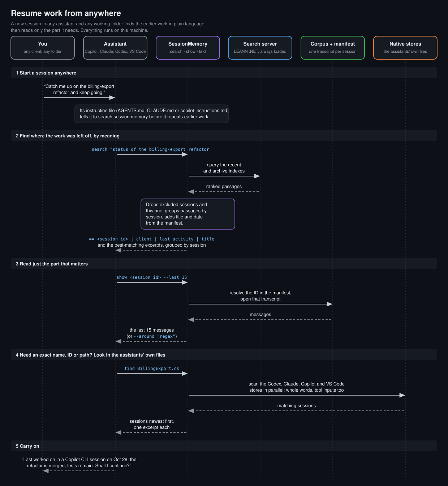
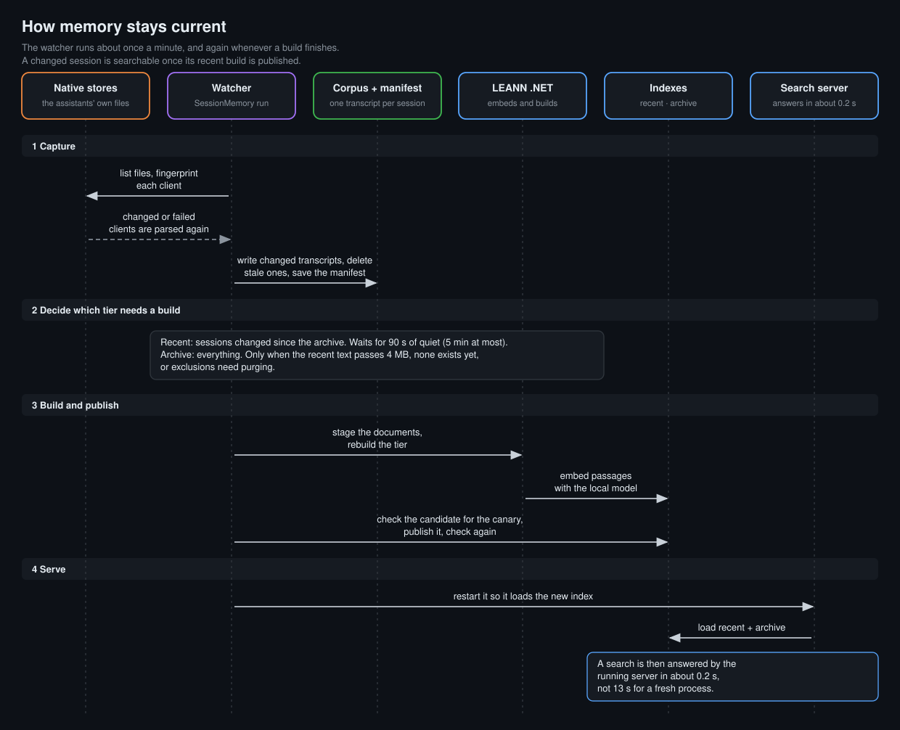

# LEANN Session Memory

A local, searchable memory of your AI coding sessions. It indexes your Codex, Claude Code, GitHub Copilot (CLI and
desktop) and VS Code Copilot Chat conversations with [LEANN .NET](https://github.com/d-german/leann-dotnet), keeps
the index current in the background, and tells those assistants how to search it. A new session can then find where
an old one left off instead of starting from a blank memory.

Everything runs on your machine: transcripts are read from each tool's local storage, embedded with a local model and
searched locally.

## Requirements

- Windows 10 or 11, macOS or Linux, and the [.NET 10 SDK](https://dotnet.microsoft.com/download/dotnet/10.0).
- About 650 MB for LEANN .NET and the `facebook/contriever` model, plus the index (about 250 MB for 50 MB of
  conversation text).
- A GPU helps: the first full index of 50 MB of text took about 19 minutes on a laptop GPU.

## Install

Open PowerShell and run:

```powershell
git clone https://github.com/d-german/leann-session-memory
cd leann-session-memory
Set-ExecutionPolicy -Scope Process -ExecutionPolicy RemoteSigned
.\Install-SessionMemory.ps1
```

The execution-policy change allows locally cloned scripts to run in this PowerShell window and expires when you
close it. It does not require administrator rights. To keep the setting for your Windows user in future sessions,
use this instead:

```powershell
Set-ExecutionPolicy -Scope CurrentUser -ExecutionPolicy RemoteSigned
```

Organization-enforced Group Policy takes precedence over both settings. If it blocks scripts, ask your administrator
for an approved way to run setup. See [PowerShell execution policies](https://learn.microsoft.com/en-us/powershell/module/microsoft.powershell.core/about/about_execution_policies?view=powershell-5.1).

The installer:

- builds the app into `%LOCALAPPDATA%\LeannSessionMemory\bin`;
- installs its own copy of LEANN .NET and downloads the model if it's missing;
- registers a hidden scheduled task, `LeannSessionMemoryRefresh`, that keeps the background watcher running;
- adds a short "Local LEANN session memory" section to `~\.codex\AGENTS.md`, `~\.claude\CLAUDE.md` and
  `~\.copilot\copilot-instructions.md`, keeping backups of the originals.

The first index builds in the background. `.\Install-SessionMemory.ps1 -Rollback` removes the task and the memory
section from the instruction files, keeping any other edits; the index is kept.

Setup saves recovery state before stopping an existing installation or replacing its files. If setup fails, it
restores the previous binaries, instruction files and scheduled task. If recovery cannot finish, it keeps the
recovery state so you can retry. Reinstall temporarily needs disk space for an extra copy of the installed app and
private LEANN files. After an interrupted setup, running setup again restores the previous installation
before retrying; running setup with `-Rollback` restores the previous installation and stops there. Run `-Rollback`
again to remove a restored installation's task and memory instructions.

If an instruction file was edited after an interrupted setup, recovery stops and retains its backups instead of
overwriting those edits. Review the named file and its saved copy before retrying recovery.

Check progress after setup with:

```powershell
& "$env:LOCALAPPDATA\LeannSessionMemory\bin\SessionMemory.exe" status
```

The first index is ready when `archive-state` has a `published_at` value. Check `watcher.errors` for failures;
`logs\watcher.log` under `%LOCALAPPDATA%\LeannSessionMemory` records background activity.

### macOS and Linux

```bash
git clone https://github.com/d-german/leann-session-memory
cd leann-session-memory
./install-sessionmemory.sh
```

The installer builds the app into the `bin` folder of the data folder (`~/.local/share/LeannSessionMemory` on Linux,
`~/Library/Application Support/LeannSessionMemory` on macOS), installs its own copy of LEANN .NET and downloads the
model if it's missing. It adds the same memory section to the instruction files of the assistants that are installed
(`~/.codex`, `~/.claude` and `~/.copilot`, keeping backups) and starts the watcher as a systemd user service on Linux
(with lingering, so it survives logout) or a launchd agent on macOS. Use the `SessionMemory` launcher in that `bin`
folder in place of `SessionMemory.exe`, and call `search` on it directly; there is no PowerShell wrapper.

- On Linux the service runs at the lowest priority with a CPU and memory cap, so it is safe on a shared machine.
  `SESSIONMEMORY_CPU_QUOTA` (default `200%`), `SESSIONMEMORY_MEMORY_HIGH_PERCENT` (`40`) and
  `SESSIONMEMORY_MEMORY_MAX_PERCENT` (`60`) change the caps. A small machine needs a while for the first index.
- `./install-sessionmemory.sh --rollback` removes the service and the memory section, keeping other edits and the
  index. `--no-service` installs without a background service (run `SessionMemory run` yourself) and `--no-start`
  writes the service definition without starting it.
- A failed install restores the previous app and instruction files. Unlike the Windows installer, it keeps no recovery
  state for an install that is killed halfway.
- Copilot CLI asks before it runs the launcher and before it reads the data folder. For a headless run, allow both:
  `copilot -p "..." --add-dir <data folder> --allow-tool "shell(<data folder>/bin/SessionMemory:*)"`.

## Use

Assistants run these commands on their own; you can too. Every command accepts `--root <path>` to use a data folder
other than `%LOCALAPPDATA%\LeannSessionMemory`, and `--help` prints the usage.



A new session in any assistant and any working folder can ask in plain language where earlier work stopped. It runs
`search` to find the sessions, `show` to read the part it needs and `find` for an exact name, then carries on; you don't
have to remember which assistant or folder the work was in.

```powershell
$memory = "$env:LOCALAPPDATA\LeannSessionMemory\bin\SessionMemory.exe"
& $memory search "what did we decide about the retry limit"   # by meaning
& $memory find RabbitMQ threat                                 # exact terms as whole words, including file edits and commands
& $memory find RAM --partial                                   # substring matching, e.g. also "param"
& $memory find RabbitMQ threat --session <session id>          # every match inside one session
& $memory find appsettings --current --since 2026-10-26T09:00  # every match in this session since a time
& $memory find NullReferenceException --current --outputs      # also search this session's Copilot CLI tool results
& $memory show <session id> --last 15                          # a session's latest messages
& $memory show <session id> --around "T15|T22"                 # messages matching a pattern
& $memory show --current --around "dotnet test"                # the same, in the session running the command
& $memory exclude <session id>                                 # drop a session from searches and indexes
& $memory include <session id>                                 # undo an exclusion
& $memory status
```

### Commands

| Command | What it does |
| --- | --- |
| `search <question>` | Searches the recent and archive indexes by meaning and prints the best passages, grouped by session. |
| `find <term> [<term> ...]` | Scans the assistants' own stores for sessions that contain every term and lists them newest first, with an excerpt. |
| `show <session-id>`, `show --current` | Prints one session from the transcript corpus: its last messages, or the ones that match a pattern. |
| `exclude <session-id>` | Hides a session and its Claude subagents from `search` and `find` at once; the watcher then removes it from both indexes. |
| `include <session-id>` | Removes an exclusion; the session becomes searchable again when the watcher rebuilds the applicable index. |
| `capture` | Updates the transcript corpus and manifest once and prints a JSON summary. It does not build an index. |
| `run` | The background watcher that the scheduled task starts. `run --once` does one refresh and exits. |
| `status` | Prints the watcher, manifest and index states and the exclusion list as JSON. |
| `self-test` | Runs the built-in checks in temporary folders and prints `{"ok": true}` when they all pass. |

Options:

- `search`: `--top-k <n>` (default 8, at most 50), `--json`, `--include-current`, `--current`.
- `find`: `--top <n>` (default 8, at most 50), `--session <id>` (every matching excerpt in that session), `--partial`
  (match inside words), `--since <time>` (ISO 8601; a time without an offset is UTC), `--outputs` (also Copilot CLI
  tool results), `--json`, `--include-current`, `--current`.
- `show`: `--last <n>` (default 10), `--around <regex>` (case-insensitive), `--context <n>` (neighboring messages
  around each match, default 0), `--max <n>` (matches shown, default 6) and `--chars <n>` (characters per message,
  default 1200). An ID prefix works when it names one session: an exact ID wins, then the only session that isn't a
  subagent.
- `exclude`, `include`: a full session ID or a prefix of at least 8 characters. The canary session can't be excluded.
- `run`: `--once` returns 0, or 1 when the refresh recorded an error. `--force` starts the index builds without waiting
  for the 90-second quiet period or the 15-minute pause after a failed build. Only one watcher or refresh runs at a
  time; a second one stops at once, and a `--once` refresh then exits with 3.

Errors go to standard error. A usage error exits with 2.

`search` and `find` print compact text grouped by session; add `--json` for machine-readable output.

`search` works best with one plain natural-language question describing what happened ("What hardware specs did I
request for my new Linux VM?"), not a list of keywords; if the top results miss, rephrase and search again. Use `find`
only for exact names, IDs, numbers, paths or error text.

`Search-SessionMemory.ps1`, the wrapper the instructions point assistants to, takes `-TopK`, `-Current`,
`-IncludeCurrent` and `-Json` for the matching `search` options.

### What search, show and find read

| Command | Reads | Sees |
| --- | --- | --- |
| `search` | the recent and archive LEANN indexes, built from the transcripts | passages of user and assistant messages with the session title, ranked by meaning |
| `show` | the manifest, to resolve the ID, then that session's transcript in `corpus\` | the same messages, in order |
| `find` | each assistant's own store: the Codex history database, Claude Code JSONL files, Copilot CLI `events.jsonl` files and VS Code chat logs | messages and tool inputs such as commands, file edits and web searches; Copilot CLI tool results with `--outputs` |

Transcripts leave out tool calls, tool results and the context the assistants inject, so `search` and `show` can't
find an exact command, path or error message that appeared only there. `find` can, because it reads the raw records.
It still skips Claude Code tool results and Codex command output, and it doesn't scan the synthetic canary.

### Recall the current session

`search` and `find` leave out the session running them, so a conversation doesn't find its own questions;
`--include-current` keeps it in the results. `--current` does the opposite and looks only at that session:
`find --current` lists every matching excerpt in it, newest first, and `show --current` reads it. With `find`,
`--since <time>` (ISO 8601) keeps only activity at or after that time, and `--outputs` also searches tool results
(GitHub Copilot CLI).

After a context compaction, an assistant can use these to recover the exact commands, decisions, errors and file paths
from earlier in its own conversation instead of guessing, re-reading files or asking again. The running session comes
from the variable its host sets for the commands it runs: `CODEX_THREAD_ID` (Codex 0.95 and later),
`CLAUDE_CODE_SESSION_ID` (Claude Code 2.1.132 and later) or `COPILOT_AGENT_SESSION_ID` (GitHub Copilot CLI), checked in
that order. VS Code sets none. When no variable is set, searches leave nothing out and `--current` fails with a message.

## How it works



The diagram follows one watcher cycle. [What search, show and find read](#what-search-show-and-find-read) lists the data
each command uses.

### Capture

`capture`, and each watcher cycle, asks every registered client for the files it watches. A client whose files (path,
size and time), exclusion list and program build are unchanged keeps its previous transcripts; the others are parsed
again. Each parsed session becomes one Markdown transcript in `corpus\` with its user and assistant messages, title and
timestamps. A client that fails to parse keeps its earlier transcripts, and the error is recorded in the manifest.
Excluded sessions are removed, changed transcripts are rewritten and transcripts of sessions that are gone are deleted.
`capture` stops there.

### Watcher and index builds

`run` captures once a minute and again whenever a build finishes, then decides which index to rebuild:

- The recent index, `session-memory-recent`, holds the sessions whose transcript differs from the last archive build,
  plus the canary. Once an archive exists, it is rebuilt after nothing has changed for 90 seconds, or 5 minutes after
  the first unbuilt change, as long as those transcripts total no more than 4 MB.
- The archive index, `session-memory`, holds every transcript. It is rebuilt when it is missing, when the changed
  transcripts pass 4 MB, or once exclusions made after its last build began have been quiet for 90 seconds.

A build copies the transcripts into a staging folder, rebuilds the index there with LEANN .NET and the local
`facebook/contriever` model, and searches the candidate for the canary conversation. It then swaps the candidate into
place, restoring the old index if the swap fails, and searches the published index for the canary again. The staging
folder is deleted however the build ends. A failed build is logged; the continuous watcher retries after 15 minutes,
while `run --once` reports the failure and exits. A failed published-index check does not restore the previous index.

After a successful published-index check, the watcher saves the index state. In continuous mode it also restarts the
resident `leann-dotnet --serve` process, which keeps both indexes loaded so a search takes about a second. When the
server isn't running, `search` starts LEANN .NET itself, which is slower, and says so.

One `search` query ranks both indexes together. It drops passages from excluded sessions, drops an archive passage
when the recent index holds the newer copy of that session, and shows at most three passages per session.

`find` scans the raw stores in parallel. A term matches only as a whole word (`RAM` doesn't match `param`) unless
`--partial` is given, and records in which a session runs the memory tools itself are skipped, so a session's own
searches don't rank it first.

## Architecture

`Program.Main` is the composition root. It handles `--help` and `--root`, builds a
Microsoft.Extensions.DependencyInjection `ServiceCollection` from three registration methods, and passes the
arguments to `CommandDispatcher`:

- `AddSessionClients` (`Clients\ClientRegistration.cs`) registers five clients, in this order: a `LambdaSessionClient`
  built from the synthetic transcript functions in `SyntheticTranscripts`, then `CodexClient`,
  `ClaudeClient`, `CopilotClient` and `VsCodeClient`.
- `AddSessionMemory` (`ServiceRegistration.cs`) registers the services: `Corpus`, `Finder`, `Indexer`, `SearchServer`,
  `SessionReader`, `StatusReport`, `ExclusionService`, `CurrentSession`, `LeannInstallation` and, for each run,
  `Watcher`.
- `AddCommands` (`Commands\CommandRegistration.cs`) registers the nine `ICommand` classes and the dispatcher.

### Three services use the client collection

`Corpus`, `Finder` and `CurrentSession` receive all registered clients as `IEnumerable<ISessionClient>`. Capture checks
each client's `Sources` and parses changed families; `find` collects each client's `FindWork`. Current-session detection
checks the registered `SessionVariable` values in order and uses the first usable ID. These services do not select one
client parser for every command. The synthetic client has no find work and no session variable, so it only feeds
capture. To add an assistant, implement `ISessionClient` and register it;
[docs/client-strategy.md](docs/client-strategy.md) describes the contract.

### Each run executes one command

`CommandDispatcher` receives all nine commands and runs the first one whose `Verb` matches the first argument, provided
the argument that verb requires is there. Anything else prints the usage and exits with 2. The dispatcher selects
exactly one `ICommand` per invocation. This command selection differs from processing the registered client collection.

A command parses its options, calls the services and turns the result into output and an exit code. Rules such as the
exclusion checks live in the services, and expected failures travel as CSharpFunctionalExtensions `Result` values until
the command reports them.

## Privacy

Nothing is redacted: credentials that appear in your sessions are indexed too. The data stays on your machine, but
results an assistant retrieves become part of that assistant's prompt.

## Limits

- Memory only knows what a session recorded; check live systems for their current state.
- On Windows the scheduled task runs only on AC power, the Windows default.

## License

MIT

## Installer tests

Run the failure-path regression checks in a temporary profile with mocked tasks and downloads:

```powershell
powershell -NoLogo -NoProfile -ExecutionPolicy Bypass -File .\tests\Test-Installer.ps1
```

The [Windows installation workflow](.github/workflows/windows-install.yml) also runs real installation, model
download, indexing, search, reinstall and rollback on fresh GitHub-hosted Windows Server 2022 and 2025 runners.
Its live test refuses to run outside GitHub Actions or over an existing installation. These checks use the CPU;
they do not cover Windows 10/11 desktop images or GPU configurations.

The same workflow runs [`tests/test-install-unix.sh`](tests/test-install-unix.sh) on GitHub-hosted `ubuntu-latest` and
`macos-latest` (Apple Silicon) runners: real installation, model download, indexing, search, reinstall and rollback.
Runners have no user service manager, so CI writes and validates the systemd unit or launchd plist but does not start
it; the Linux service has been run on an Ubuntu VM only. Intel Macs and Linux on arm64 are untested.
