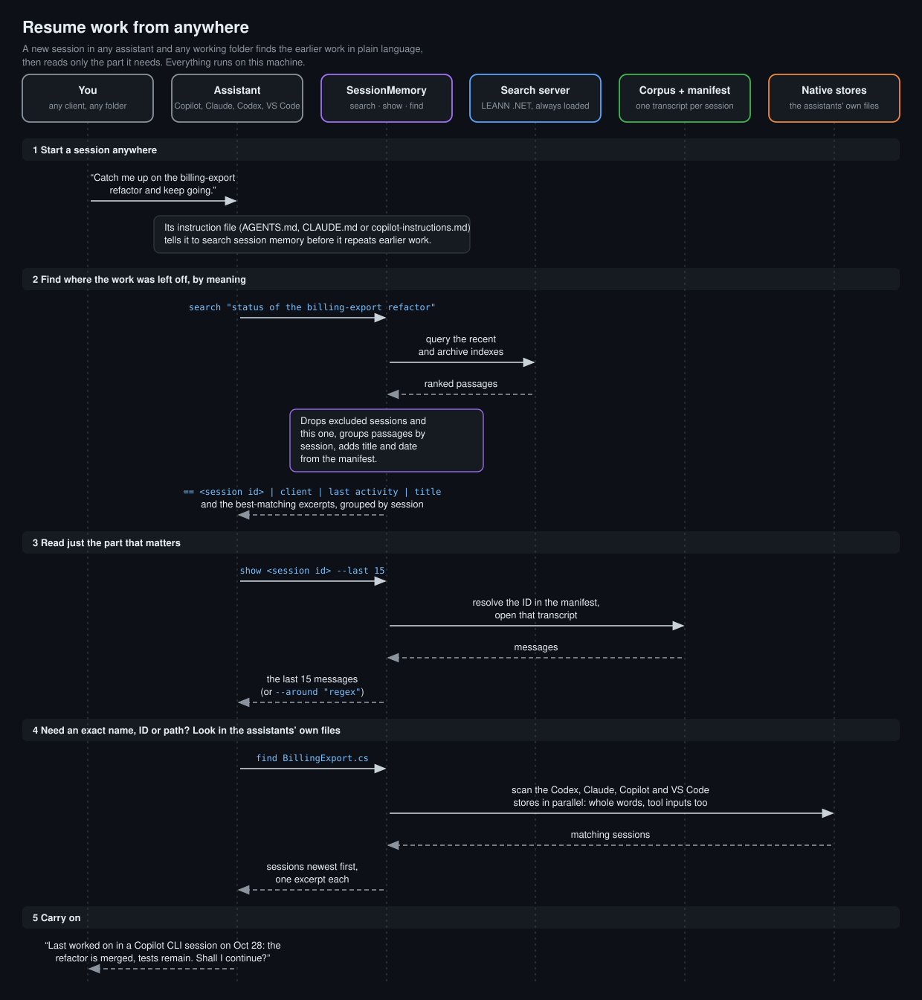
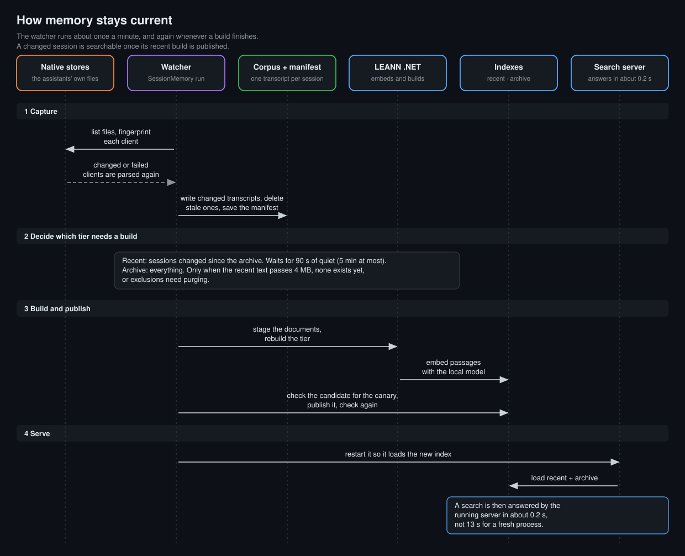

# LEANN Session Memory

Pick up earlier work from a new AI session, even when you change assistants or folders. Ask in plain language, for
example "catch me up on the billing-export refactor". SessionMemory finds the earlier conversations so you can recover
decisions, see what was tried and continue unfinished work without remembering where the discussion happened.

It gives Codex, Claude Code, GitHub Copilot (CLI and desktop) and VS Code Copilot Chat a local, searchable history of
your conversations. The assistant can read selected excerpts, then the relevant parts of a source session to check
the context. SessionMemory combines a local SQLite search cache with [LEANN .NET](https://github.com/d-german/leann-dotnet)
semantic retrieval, keeps the cache current in the background, and tells those assistants how to search it.

The frozen October 30, 2026 benchmark snapshot covered about eight months of coding history:

| History searched | Size or coverage |
| --- | --- |
| Time span | February to October 2026 |
| Indexed source records | 1,240, including subagent sessions and a validation record |
| Raw transcript export | About 4.03 GB |
| Normalized conversation corpus | About 59.7 MB |

Both methods searched the same source history. Raw logs included richer original tool outputs. These sizes describe
the transcript data, excluding the embedding model, search indexes and application files.

In the latest blind comparison using Claude Opus 5.5, memory matched raw-log search on accuracy while using less time
and fewer tokens. Ten previously discussed questions were run once per method:

| Measure | Raw-log search | SessionMemory |
| --- | ---: | ---: |
| Core answer correct | 8/10 | 8/10 |
| Fully supported answer | 7/10 | 7/10 |
| Mean response time | 198.6 s | 61.6 s |
| Mean total tokens | 937,171 | 242,837 |
| Mean uncached tokens | 81,732 | 39,744 |

Memory used **69.0% less time, 74.1% fewer total tokens and 51.4% fewer uncached tokens** on the same nine completed
pairs. Accuracy includes all ten questions per method: raw search timed out once at 15 minutes; memory completed all
ten. The timeout has no token accounting and is excluded from both methods' paired means. Fully supported means the
main answer is correct, its evidence and citations hold up, and it contains no unsupported extra claims.

**Total tokens** count all input and output, including input reused from the answering model's prompt cache.
**Uncached tokens** subtract cache-read input: `input - cache-read + output`; cache writes remain included in input.
For example, 100,000 input tokens, 80,000 cache-read tokens and 2,000 output tokens mean 102,000 total tokens and
22,000 uncached tokens. This model-level prompt cache is separate from SessionMemory's local search cache.
The 51.4% uncached reduction shows that savings remained after subtracting reused input; neither measure is a bill.

These are measured workflow results from a small, previously seen sample, not general accuracy or billing guarantees.
The measured frozen build predates the subsequent code review and cleanup; that revised build has not repeated the model benchmark.
Setup and indexing were excluded; raw logs included richer original tool outputs. See the
[Opus comparison](docs/benchmarks/opus-memory-vs-raw.md) for the method, grading and limits. The
[Sonnet comparison](docs/benchmarks/updated-memory-vs-raw.md), [earlier direct-log benchmark](docs/benchmarks/2026-10-30-history-retrieval.md)
and [V3 tool-to-tool evaluation](docs/benchmarks/general-retrieval-v3.md) preserve the earlier results.



Everything runs on your machine: transcripts are read from each tool's local storage, embedded with a local model and
searched locally.

## Requirements

- Windows 10 or 11, macOS or Linux, and the [.NET 10 SDK](https://dotnet.microsoft.com/download/dotnet/10.0).
- About 650 MB for LEANN .NET and the `facebook/contriever` model, plus the transcript corpus and search data. Storage
  use depends on the history size.
- The earlier LEANN full-index pass took about 19 minutes for 50 MB of text on a laptop GPU. Current cache warmup is
  separate from warm-query time.

## Install

Open PowerShell and run:

```powershell
git clone https://github.com/d-german/leann-session-memory
cd leann-session-memory
Set-ExecutionPolicy -Scope Process -ExecutionPolicy RemoteSigned
.\Install-SessionMemory.ps1
```

The execution-policy change allows locally cloned scripts to run in this PowerShell window and expires when you
close it. It does not require administrator rights. To keep the setting for your Windows user in future sessions,
use this instead:

```powershell
Set-ExecutionPolicy -Scope CurrentUser -ExecutionPolicy RemoteSigned
```

Organization-enforced Group Policy takes precedence over both settings. If it blocks scripts, ask your administrator
for an approved way to run setup. See [PowerShell execution policies](https://learn.microsoft.com/en-us/powershell/module/microsoft.powershell.core/about/about_execution_policies?view=powershell-5.1).

The installer:

- builds the app into `%LOCALAPPDATA%\LeannSessionMemory\bin`;
- installs its own copy of LEANN .NET and downloads the model if it's missing;
- captures session history and prepares the local SQLite search cache before reporting success;
- registers a hidden scheduled task, `LeannSessionMemoryRefresh`, that keeps the background watcher running;
- adds a short "Local LEANN session memory" section to `~\.codex\AGENTS.md`, `~\.claude\CLAUDE.md` and
  `~\.copilot\copilot-instructions.md`, keeping backups of the originals.

Setup waits for the initial capture and search-cache preparation before starting the background watcher and reporting
success. The first cache warmup cost is separate from a warm search.
`.\Install-SessionMemory.ps1 -Rollback` removes the task and the memory
section from the instruction files, keeping any other edits; the corpus and cache are kept.

Setup saves recovery state before stopping an existing installation or replacing its files. If setup fails, it
restores the previous binaries, instruction files and scheduled task. If recovery cannot finish, it keeps the
recovery state so you can retry. Reinstall temporarily needs disk space for an extra copy of the installed app and
private LEANN files. After an interrupted setup, running setup again restores the previous installation
before retrying; running setup with `-Rollback` restores the previous installation and stops there. Run `-Rollback`
again to remove a restored installation's task and memory instructions.

If an instruction file was edited after an interrupted setup, recovery stops and retains its backups instead of
overwriting those edits. Review the named file and its saved copy before retrying recovery.

Check watcher and cache status with:

```powershell
& "$env:LOCALAPPDATA\LeannSessionMemory\bin\SessionMemory.exe" status
```

The status output reports watcher and cache activity. Check `watcher.errors` for failures; `logs\watcher.log` under
`%LOCALAPPDATA%\LeannSessionMemory` records background activity.

### macOS and Linux

```bash
git clone https://github.com/d-german/leann-session-memory
cd leann-session-memory
./install-sessionmemory.sh
```

The installer builds the app into the `bin` folder of the data folder (`~/.local/share/LeannSessionMemory` on Linux,
`~/Library/Application Support/LeannSessionMemory` on macOS), installs its own copy of LEANN .NET and downloads the
model if it's missing. It adds the same memory section to the instruction files of the assistants that are installed
(`~/.codex`, `~/.claude` and `~/.copilot`, keeping backups). Normal setup captures the history and prepares the search
cache, then starts the watcher as a systemd user service on Linux
(with lingering, so it survives logout) or a launchd agent on macOS. Use the `SessionMemory` launcher in that `bin`
folder in place of `SessionMemory.exe`, and call `search` on it directly; there is no PowerShell wrapper.

- On Linux the service runs at the lowest priority with a CPU and memory cap, so it is safe on a shared machine.
  `SESSIONMEMORY_CPU_QUOTA` (default `200%`), `SESSIONMEMORY_MEMORY_HIGH_PERCENT` (`40`) and
  `SESSIONMEMORY_MEMORY_MAX_PERCENT` (`60`) change the caps. These service limits do not apply to setup's foreground
  cache preparation. The first cache warmup is separate from normal warm searches.
- `./install-sessionmemory.sh --rollback` removes the service and the memory section, keeping other edits and the
  corpus and cache. `--no-service` installs without a background service (run `SessionMemory run` yourself) and `--no-start`
  writes the service definition without starting it. Both options skip initial indexing; run
  `SessionMemory run --once --progress` when you are ready to build the first index.
- A failed install restores the previous app and instruction files. Unlike the Windows installer, it keeps no recovery
  state for an install that is killed halfway.
- Copilot CLI asks before it runs the launcher and before it reads the data folder. For a headless run, allow both:
  `copilot -p "..." --add-dir <data folder> --allow-tool "shell(<data folder>/bin/SessionMemory:*)"`.

## Use

Assistants run these commands on their own; you can too. Every command accepts `--root <path>` to use a data folder
other than `%LOCALAPPDATA%\LeannSessionMemory`, and `--help` prints the usage.

```powershell
$memory = "$env:LOCALAPPDATA\LeannSessionMemory\bin\SessionMemory.exe"
& $memory search "what did we decide about the retry limit"   # by meaning
& $memory search "why did we choose SQLite FTS5" --latest
& $memory search "what did we decide about SQLite" --session <session id>
& $memory search "what tradeoff did we accept?" --session <session id>
& $memory show <session id> --message <positive message number> --context 1 --chars 6000
& $memory timeline retry limit --top 12
& $memory related <source session id> --message <positive message number> --top 12
& $memory search "compare two approaches" --exclude-topic "second approach"
& $memory find deployment                                     # exact terms as whole words, including file edits and commands
& $memory find RAM --partial                                   # substring matching, e.g. also "param"
& $memory find deployment --session <session id>               # every match inside one session
& $memory find appsettings --current --since "<ISO time>"      # every match in this session since a time
& $memory find NullReferenceException --current --outputs      # also search this session's Copilot CLI tool results
& $memory show <session id> --last 15                          # a session's latest messages
& $memory show <session id> --around "T15|T22"                 # messages matching a pattern
& $memory show --current --around "dotnet test"                # the same, in the session running the command
& $memory exclude <session id>                                 # drop a session from search and cache
& $memory include <session id>                                 # undo an exclusion
& $memory status
```

### Commands

| Command | What it does |
| --- | --- |
| `search <question>` | Searches the transcript corpus by lexical and semantic relevance; prints cited message windows grouped by session. |
| `find <term> [<term> ...]` | Scans the assistants' own stores for sessions that contain every term and lists them newest first, with an excerpt. |
| `timeline <literal-term> [<term> ...]` | Finds literal OR-term matches across visible cached messages, with original UTC dates and paging markers. |
| `related <source-id> --message <n>` | Follows explicit URI or known-session references from one cited source message for navigation. |
| `show <session-id>`, `show --current` | Prints selected original messages, the latest messages, or messages that match a pattern. |
| `verify <claims-json-file>` | Checks quoted claims against their cited original messages and returns neighboring context. |
| `exclude <session-id>` | Hides a session and its Claude subagents from search and find; the watcher removes them from the corpus and cache. |
| `include <session-id>` | Removes an exclusion; the session becomes searchable again after the next capture and cache refresh. |
| `capture` | Updates the transcript corpus and manifest once and prints a JSON summary. It does not prepare the search cache. |
| `run` | The background watcher. `run --once --progress` refreshes once, prints progress and exits. |
| `status` | Prints watcher, manifest, search-cache state, build progress and exclusion list as JSON. |
| `self-test` | Runs the built-in checks in temporary folders and prints `{"ok": true}` when they all pass. |

Options:

- `search`: `--top-k <n>` (default 8 windows, at most 50), `--latest`, `--session <id>`,
  `--exclude-topic <literal phrase>`, `--json`, `--include-current`, `--current`.
  `--session` narrows search to one known session; IDs or prefixes need at least 8 characters and conflict with
  `--current`. `--exclude-topic` removes windows containing that literal phrase only when specified. Ordinary query
  wording does not imply negation, so comparisons can retain both sides.
- `timeline`: `--top <n>` (default 12, at most 50), `--cursor <opaque value>`, `--include-current`, `--json`.
  It scans visible cached original messages for any literal term; it does not rank by relevance, infer work from a match,
  or limit its search to a top-200 candidate list. Output shows UTC dates, undated-message counts, truncation and stale
  cursor markers. Matching uses invariant case-folding but no Unicode composition normalization, so code-point sequences
  must match.
- `related`: requires a source session and positive original message number; accepts `--top <n>` and `--json`.
  It follows one hop of explicit HTTP(S) URIs and full known session IDs, preserving exact path, query and fragment.
  It does not infer branches or topics or fetch web pages. A focused comment URI is not treated as its base page.
- `verify`: accepts a UTF-8 JSON file no larger than 64 KiB with `{ "claims": [{ "claim": "...", "session_id": "...", "message_number": 1, "quote": "..." }] }` and at most 12 claims. Run `& $memory verify <claims-json-file>`.
- `find`: `--top <n>` (default 8, at most 50), `--session <id>` (every matching excerpt in that session), `--partial`
  (match inside words), `--since <time>` (ISO 8601; a time without an offset is UTC), `--outputs` (also Copilot CLI
  tool results), `--json`, `--include-current`, `--current`.
- `show`: `--message <number>` reads one positive original message number; `--offset <n>` starts at a
  nonnegative UTF-16 character offset and is valid only with `--message`. It preserves the normalized corpus message,
  including blank lines and whitespace at part boundaries. This is not a byte-for-byte copy of the raw client log.
  Output shows `[offset N; next offset N/end; total N UTF-16 units]`. A requested offset can move back to a word
  or surrogate boundary; the displayed offset is where reading actually starts. An offset past the message errors. Use
  the displayed next offset to read the next portion and
  continue if it is clipped. `--context <n>` (0 to 5, default 0) reads neighboring messages; `--chars <n>` (200 to
  20,000, default 1200) sets the character limit per message. `--message` conflicts with `--around`; a missing exact
  message exits with 2. `--last <n>` (default 10), `--around <regex>` and `--max <n>` (default 6) remain available.
  An ID prefix needs to identify one session: an exact ID wins, then the only session that isn't a subagent.
- `exclude`, `include`: a full session ID or a prefix of at least 8 characters. The canary session can't be excluded.
- `run`: `--once` returns 0, or 1 when the refresh recorded an error. `--force` starts cache preparation without waiting
  for the 90-second quiet period or the 15-minute pause after a failed build. Only one watcher or refresh runs at a
  time; a second one stops at once, and a `--once` refresh then exits with 3. `--progress` prints refresh progress to
  standard output. The installers use `run --once --progress` before starting the
  background watcher. A reinstall refreshes changed history incrementally.
  A one-time refresh also fails if any history reader fails, so setup cannot report readiness for a partial capture.

Errors go to standard error. A usage error exits with 2.

`search` and `find` print compact text grouped by session; add `--json` for machine-readable output.

`search` works best with one plain-language question. It combines SQLite FTS5 Porter BM25 over overlapping windows of
logical neighboring messages with LEANN semantic windows, fused with RRF at 60. Standard camel-case, identifier and date
aliases support lexical matching. For a multi-term lexical match, the topic and another positive query term must appear
in the same source passage. Source-matched LEANN windows can also qualify when the topic appears somewhere in the message,
or when no query words overlap, as with a paraphrase. Generic qualifier-only matches are dropped. Results cite original
messages with role and timestamp; one source can contribute multiple windows.

The default returns up to 8 windows (up to 50 with `--top-k`) within a 12,000-character actual-text budget. Search runs
locally without an LLM. A first cache build has its own warmup cost, separate from a warm query. Use `--latest` to
include message dates in ranking alongside relevance. It does not guarantee complete history or prove which state is
current.

`timeline <literal-term> [<term> ...]` is a chronological navigation tool. It scans visible cached original messages
for any supplied literal term; it does not rank by relevance, limit itself to a top-200 list, or prove that a matching
session did the work. It reports original UTC dates, undated status, result counts, truncation and stale-cursor markers.
`--cursor` is an opaque continuation value. Term matching uses invariant case-folding but no Unicode composition
normalization, so composed and decomposed spellings can differ.

`related <source-id> --message <n>` reads explicit HTTP(S) URIs and full known session IDs found in one source message.
It returns the referring and target message citations and visible navigation to known sessions. It follows one hop only:
no branch-number or topic inference, and no web fetch. URI path, query and fragment must match exactly; a focused comment
link is not treated as its base page. A shared reference is a navigation hint, not proof that two sessions describe the
same work.

For a history question, start with a plain-language search and identify relevant session IDs. Before answering, search
again for the specific fact within each relevant session, then read its original cited message:

```powershell
& $memory search "what tradeoff did we accept?" --session <session id>
& $memory show <session id> --message <positive original message number> --offset <offset> --context 1 --chars 6000
```

For latest/history questions, use `timeline` with actual subject terms to locate candidate sessions, then use scoped
`search` and exact `show --message` reading to establish the relevant work. From a specific cited message, use
`related` only when an explicit URI or full session-ID reference may lead to an indirect update. Do not open every
related session wholesale.

The first search windows are leads, not the full answer. Follow a navigation result's singular `read_hint` command as
printed; it may include an `--offset`. Search results' `read_context` starts at the original message beginning and has
no offset. `show --message` returns the joined original message, preserving blank lines, and its UTC timestamp. Offsets
count UTF-16 code units. Output shows `[offset N; next offset N/end; total N UTF-16 units]`; the displayed offset is
where reading actually starts and may move back to a word or surrogate boundary. If output contains an omission marker,
continue with the displayed next offset, refine the search, or say the evidence is unknown; never assume clipped text is
complete. `--around` and `--last` remain available for locating context.

If a lookup or summary names an earlier work session, search that original session or title and attribute the work to its
authoring session, not the reporting session. For date-bound questions, compare relevant message timestamps in UTC, not
session last activity. Do not use a future event to answer a past-state question or claim something is globally latest
without enough coverage. State only material facts the user asked for. A proposal, intention or request does not prove
the action was completed.

Search does not follow issue, PR or branch links automatically; include ticket IDs and URLs in the query when relevant.
Cite claims with source session, message and date, and distinguish proposals, patches, merges, publication and
verification. Use `find` for exact names, IDs, numbers, paths or error text.

`--exclude-topic <literal phrase>` explicitly filters matching windows. The ordinary question is not interpreted as a
set of exclusions: a query comparing A with “not B” can still return evidence about both. Search filtering is heuristic,
not proof of semantic scope.

`verify` checks that each quote appears in the cited original message and returns nearby context within a 12,000-character
source budget. It checks quotation, not semantic support; review the source and any relevant later updates before using
the claim. A quote match alone does not establish that the claim is true.

`Search-SessionMemory.ps1`, the wrapper the instructions point assistants to, takes `-TopK`, `-Latest`, `-Session`,
`-ExcludeTopic`, `-Current`, `-IncludeCurrent` and `-Json` for the matching `search` options.

### What search, timeline, related, show and find read

| Command | Reads | Sees |
| --- | --- | --- |
| `search` | the transcript corpus and derived SQLite FTS5 cache | source-matched windows of user and assistant messages, with role, timestamp and citation |
| `timeline` | visible original messages in the SQLite cache | literal-term matches with UTC dates, counts and paging status |
| `related` | one cited source message and its explicit references | referring and target citations, plus navigation to known sessions |
| `show` | the manifest, to resolve the ID, then that session's transcript in `corpus\` | the same messages, in order |
| `find` | each assistant's own store: the Codex history database, Claude Code JSONL files, Copilot CLI `events.jsonl` files and VS Code chat logs | messages and tool inputs such as commands, file edits and web searches; Copilot CLI tool results with `--outputs` |

Transcripts leave out tool calls, tool results and the context the assistants inject, so `search`, `timeline`, `related`
and `show` can't
find an exact command, path or error message that appeared only there. `find` can, because it reads the raw records.
It still skips Claude Code tool results and Codex command output, and it doesn't scan the synthetic canary.

### Recall the current session

`search`, `find` and `timeline` leave out the session running them, so a conversation doesn't find its own questions;
`--include-current` keeps it in the results. `--current` does the opposite and looks only at that session:
`find --current` lists every matching excerpt in it, newest first, and `show --current` reads it. With `find`,
`--since <time>` (ISO 8601) keeps only activity at or after that time, and `--outputs` also searches tool results
(GitHub Copilot CLI).

After a context compaction, an assistant can use these to recover the exact commands, decisions, errors and file paths
from earlier in its own conversation instead of guessing, re-reading files or asking again. The running session comes
from the variable its host sets for the commands it runs: `CODEX_THREAD_ID` (Codex 0.95 and later),
`CLAUDE_CODE_SESSION_ID` (Claude Code 2.1.132 and later) or `COPILOT_AGENT_SESSION_ID` (GitHub Copilot CLI), checked in
that order. VS Code sets none. When no variable is set, searches leave nothing out and `--current` fails with a message.

## How it works



The diagram shows the previous search-index build flow. [What search, show and find read](#what-search-show-and-find-read)
lists the current data each command uses.

### Capture

`capture`, and each watcher cycle, asks every registered client for the files it watches. A client whose files (path,
size and time), exclusion list and program build are unchanged keeps its previous transcripts; the others are parsed
again. Each parsed session becomes one Markdown transcript in `corpus\` with its user and assistant messages, title and
timestamps. A client that fails to parse keeps its earlier transcripts, and the error is recorded in the manifest.
Excluded sessions are removed, changed transcripts are rewritten and transcripts of sessions that are gone are deleted.
`capture` stops there.

### Watcher and search cache

`run` captures once a minute. Each capture prepares the incremental SQLite search cache from the transcript corpus.
The installer waits for the initial capture and cache preparation before reporting success.

The derived cache is `state/conversation-search.sqlite`. It uses SQLite FTS5 Porter BM25 and LEANN semantic windows.
FTS5 comes from the native OS SQLite library, already tested in the Windows build; no NuGet, Python or separate
model-provider dependency is added. A missing cache is
rebuilt from the corpus. Changed transcript hashes refresh their messages; deleted or excluded messages are removed.
Cache corruption currently raises an error; it is not automatically repaired. Do not remove the whole memory data
folder to rebuild search, because that folder also holds the corpus and other state.

Corpus and cache formats are versioned. A transcript-format change triggers recapture, and an incompatible SQLite cache
is rebuilt from the corpus. Message lengths preserve boundaries when the text itself contains transcript headings.
The semantic index uses a versioned namespace while the legacy namespace is retained for rollback. Saved exclusions
are preserved; the upgrade performs an initial full semantic regeneration.

The first cache warmup cost is separate from a warm query. Search runs locally without an LLM. If the local SQLite build
lacks FTS5, installation fails with an error instead of silently skipping lexical search. If a result is not enough, the
calling assistant can run another search with a more specific query.

`find` scans the raw stores in parallel. A term matches only as a whole word (`RAM` doesn't match `param`) unless
`--partial` is given, and records in which a session runs the memory tools itself are skipped, so a session's own
searches don't rank it first.

## Architecture

`Program.Main` is the composition root. It handles `--help` and `--root`, builds a
Microsoft.Extensions.DependencyInjection `ServiceCollection` from three registration methods, and passes the
arguments to `CommandDispatcher`:

- `AddSessionClients` (`Clients\ClientRegistration.cs`) registers five clients, in this order: a `LambdaSessionClient`
  built from the synthetic transcript functions in `SyntheticTranscripts`, then `CodexClient`,
  `ClaudeClient`, `CopilotClient` and `VsCodeClient`.
- `AddSessionMemory` (`ServiceRegistration.cs`) registers the services: `Corpus`, `Finder`, `Indexer`, `SearchServer`,
  `SessionReader`, `ClaimVerifier`, `HistoryNavigation`, `StatusReport`, `ExclusionService`, `CurrentSession`, `LeannInstallation` and, for each run,
  `Watcher`.
- `AddCommands` (`Commands\CommandRegistration.cs`) registers the `ICommand` classes and the dispatcher.

### Three services use the client collection

`Corpus`, `Finder` and `CurrentSession` receive all registered clients as `IEnumerable<ISessionClient>`. Capture checks
each client's `Sources` and parses changed families; `find` collects each client's `FindWork`. Current-session detection
checks the registered `SessionVariable` values in order and uses the first usable ID. These services do not select one
client parser for every command. The synthetic client has no find work and no session variable, so it only feeds
capture. To add an assistant, implement `ISessionClient` and register it;
[docs/client-strategy.md](docs/client-strategy.md) describes the contract.

### Each run executes one command

`CommandDispatcher` receives the registered commands and runs the first one whose `Verb` matches the first argument, provided
the argument that verb requires is there. Anything else prints the usage and exits with 2. The dispatcher selects
exactly one `ICommand` per invocation. This command selection differs from processing the registered client collection.

A command parses its options, calls the services and turns the result into output and an exit code. Rules such as the
exclusion checks live in the services, and expected failures travel as CSharpFunctionalExtensions `Result` values until
the command reports them.

## Privacy

Nothing is redacted: credentials that appear in your sessions are indexed too. The data stays on your machine, but
results an assistant retrieves become part of that assistant's prompt.

## Limits

- Memory only knows what a session recorded; check live systems for their current state.
- On Windows the scheduled task runs only on AC power, the Windows default.

## License

MIT

## Installer tests

Run the failure-path regression checks in a temporary profile with mocked tasks and downloads:

```powershell
powershell -NoLogo -NoProfile -ExecutionPolicy Bypass -File .\tests\Test-Installer.ps1
```

The [Windows installation workflow](.github/workflows/windows-install.yml) also runs real installation, model
download, indexing, search, reinstall and rollback on fresh GitHub-hosted Windows Server 2022 and 2025 runners.
Its live test refuses to run outside GitHub Actions or over an existing installation. These checks use the CPU;
they do not cover Windows 10/11 desktop images or GPU configurations.

The same workflow runs [`tests/test-install-unix.sh`](tests/test-install-unix.sh) on GitHub-hosted `ubuntu-latest` and
`macos-latest` (Apple Silicon) runners: real installation, model download, indexing, search, reinstall and rollback.
Runners have no user service manager, so CI writes and validates the systemd unit or launchd plist but does not start
it; the Linux service has been run on an Ubuntu VM only. Intel Macs and Linux on arm64 are untested.
