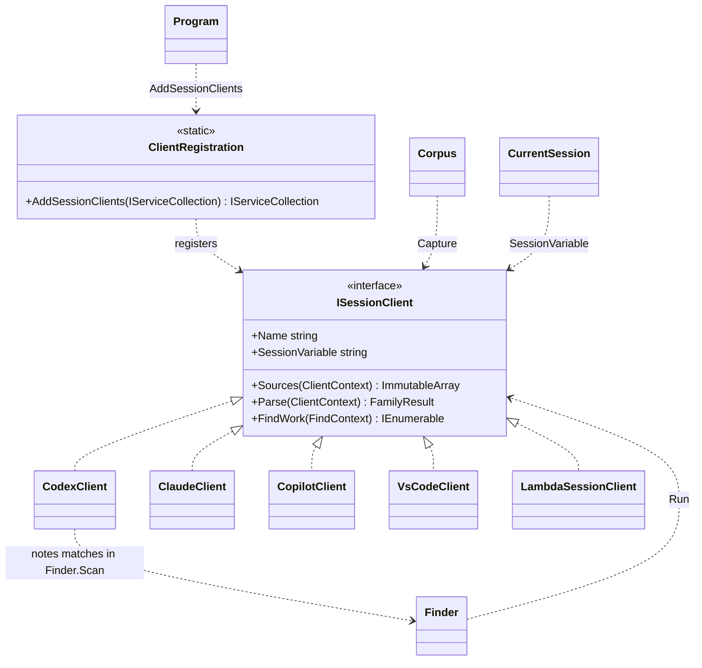

# Client strategy

SessionMemory reads the local stores of several AI assistants ("clients"): Codex, Claude Code, GitHub Copilot (CLI and
desktop) and VS Code Copilot Chat, plus a synthetic client that holds the canary conversation. Everything that differs
between them sits behind one interface, `ISessionClient`. Capture, find and current-session detection work through that
interface and never name a particular client.

## Why

Before this structure, knowledge of each client was spread over three places:

| File | Client-specific code |
| --- | --- |
| `Parsers.cs`, `Parsers.CopilotVsCode.cs` | `Parsers.All(home, root)` built a `Family` record (name, sources delegate, parse delegate) per client; all four parsers shared one static class. |
| `Finder.cs` | `WorkItems` built the find work list with one hard-coded block per client (Codex row ranges, Claude JSONL files, Copilot event files, VS Code chat files with a session map taken from the manifest), followed by `ScanCodex`, `ScanClaude`, `ScanCopilot` and `ScanVsCode`. |
| `Corpus.cs` | `CurrentSessionVariables` listed `COPILOT_AGENT_SESSION_ID`, `CODEX_THREAD_ID` and `CLAUDE_CODE_SESSION_ID`. |

Adding a client meant editing all three files, and code that has to agree lived apart: the Claude parser and the Claude
find scanner both derive subagent session IDs (`<id>:subagent:<file stem>`), one in `Parsers.cs` and one in `Finder.cs`.

## Structure

| Role | Code |
| --- | --- |
| Contract | `ISessionClient` (`Clients\ISessionClient.cs`) |
| Client implementations | `CodexClient`, `ClaudeClient`, `CopilotClient`, `VsCodeClient`, one folder each under `Clients\` |
| Delegate-based implementation | `LambdaSessionClient`, used for the synthetic client (`Clients\Synthetic\SyntheticTranscripts.cs`) |
| Inputs | `ClientContext` (home and root folders), `FindContext` (home folder, manifest documents, `--outputs`) |
| Registration | `ClientRegistration.AddSessionClients()` (`Clients\ClientRegistration.cs`), the only code that names the implementations |
| Consumers | `Corpus`, `Finder` and `CurrentSession`, which receive `IEnumerable<ISessionClient>` through their constructors |
| Wiring | `Program.Main` builds the `ServiceCollection` (`AddSessionClients`, `AddSessionMemory`, `AddCommands`) and runs the command |

```csharp
internal interface ISessionClient
{
    string Name { get; }                       // manifest family key, e.g. "codex"
    string? SessionVariable { get; }           // variable the host sets for the commands it runs, or null
    ImmutableArray<string> Sources(ClientContext context);
    FamilyResult Parse(ClientContext context);
    IEnumerable<Action<Finder.Scan>> FindWork(FindContext context);
}
```

Each client class is partial and owns all of its client's code:

```text
Clients\
  ISessionClient.cs  ClientContext.cs  FindContext.cs  LambdaSessionClient.cs  ClientRegistration.cs
  Codex\     CodexClient.cs (locations)  CodexClient.Parse.cs  CodexClient.Find.cs
  Claude\    ClaudeClient.cs             ClaudeClient.Parse.cs ClaudeClient.Find.cs
  Copilot\   CopilotClient.cs            CopilotClient.Parse.cs CopilotClient.Find.cs
  VsCode\    VsCodeClient.cs             VsCodeClient.Parse.cs VsCodeClient.Replay.cs VsCodeClient.Find.cs
  Synthetic\ SyntheticTranscripts.cs
SourceFiles.cs     file listing shared by all clients (Rglob, DatabaseFiles)
ParserHelpers.cs   Stats, Number and Add, shared by all parsers
Finder.cs          the find engine: Scan, Found, Excerpt, Utc, Lines
```

The contract lives in `SessionMemory.Clients`; each implementation lives in `SessionMemory.Clients.<Client>`. Only
`ClientRegistration` and the self-test import the per-client namespaces; `Corpus`, `Finder` and `CurrentSession` import only
`SessionMemory.Clients`.

The clients keep no state. Everything comes from the context argument, so each is registered as a singleton and a test can
point any client at a temporary home folder.



## Invariants

- `IEnumerable<ISessionClient>` resolves in registration order: synthetic, codex, claude, copilot, vscode. That is the key
  order of the manifest's `families` object and the order find hands out work, which puts the Codex row ranges, the
  longest items, first.
- `CurrentSession` reads the clients' `SessionVariable` values in the same order (codex, claude, copilot); the first variable
  that holds a usable ID wins. Only one is normally set, because each host sets its own.
- Every document a client's `Parse` returns has `Family == Name`. `Corpus.Capture` keeps a family's previous documents
  when its parse fails, and it matches them by that field.
- `FindWork` may be lazy; `Finder.Run` materializes all work items before the parallel scan starts.

## Adding a client

1. Create `Clients\<Client>\<Client>Client.cs` in namespace `SessionMemory.Clients.<Client>` with a
   `sealed internal partial class` that implements `ISessionClient`:
   - `Name`: a new manifest family key. Use the same value as the `Family` of every document `Parse` returns.
   - `SessionVariable`: the variable the client's host sets for the commands it runs, or `null`.
   - `Sources`: every file whose size or timestamp should trigger a re-parse, including SQLite `-wal` files
     (`SourceFiles.DatabaseFiles`).
   - `Parse`: one `Document` per session, with stats created by `ParserHelpers.Stats` in a fixed order.
   - `FindWork`: one work item per file or row range, largest first; return an empty sequence if raw search is not
     supported.
2. Put parsing and scanning in `<Client>Client.Parse.cs` and `<Client>Client.Find.cs` as private static members.
3. Add one line to `ClientRegistration.AddSessionClients()`: `.AddSingleton<ISessionClient, <Client>Client>()`. Adding it
   last keeps the existing manifest order. A `SessionVariable` is picked up by `CurrentSession` automatically.
4. Add a fixture to `SelfTest.Replay.cs` (`ParserHome`) and extend the registration checks.

`Corpus`, `Finder`, `CurrentSession`, the commands and `Program` do not change.

## Class-based and delegate-based clients

`LambdaSessionClient` implements `ISessionClient` from delegates: a name, a sources function, a parse function and,
optionally, a find-work function and a session variable. Consumers cannot tell it from a class-based client.

- A dedicated class fits a client with real logic: private helpers, nested types (`CopilotClient.AssistantMessage`),
  regexes and several files. The class keeps that code together and hides it.
- Delegates fit a client that is a few functions with no find work and no host, such as the synthetic client, and
  test doubles: the self-test builds failing, partial and unreadable clients inline with `LambdaSessionClient`.

## Design notes

### Why one interface instead of one per client

The consumers iterate over all clients through one contract. Interfaces such as `ICodexClient` or `IClaudeClient` would
make every caller know each concrete type again, which is the scattering this structure removes. Client-specific
helpers that the self-test calls directly, such as `CodexClient.StripInjectedContext` or `VsCodeClient.Replay`, stay
static members of the client class rather than part of the contract.

### Why FindContext carries the manifest documents

VS Code chat files are reported under the session ID of their last capture, not their file name. `VsCodeClient`
builds that map from `FindContext.Documents`, so the client neither loads the manifest itself nor depends on `Corpus`.

### Testing through the interface

`Corpus` and `Finder` receive the clients through their constructors, so a test registers other clients instead of
calling `AddSessionClients()`. `SelfTest.Finder.cs` defines a `FakeClient` that reads no files and builds a service
provider with only that client, then checks that find returns its session and that find returns nothing when no client
is registered.

## When this structure is not worth it

- With one or two clients and no prospect of more, a single function per operation is simpler to read.
- If clients differed only in data (paths, file patterns, variable names), a table of settings would be enough.
- The interface adds a level of indirection: following a capture now goes from `Corpus` through `ISessionClient` to
  the client class.
- A change to the contract touches every implementation, including `LambdaSessionClient` and the test double.
- Shared code between operations of one client is still duplicated where it was before. For example,
  `ClaudeClient.Parse.cs` and `ClaudeClient.Find.cs` both detect subagent files; the structure puts them side by side
  but does not merge them.
